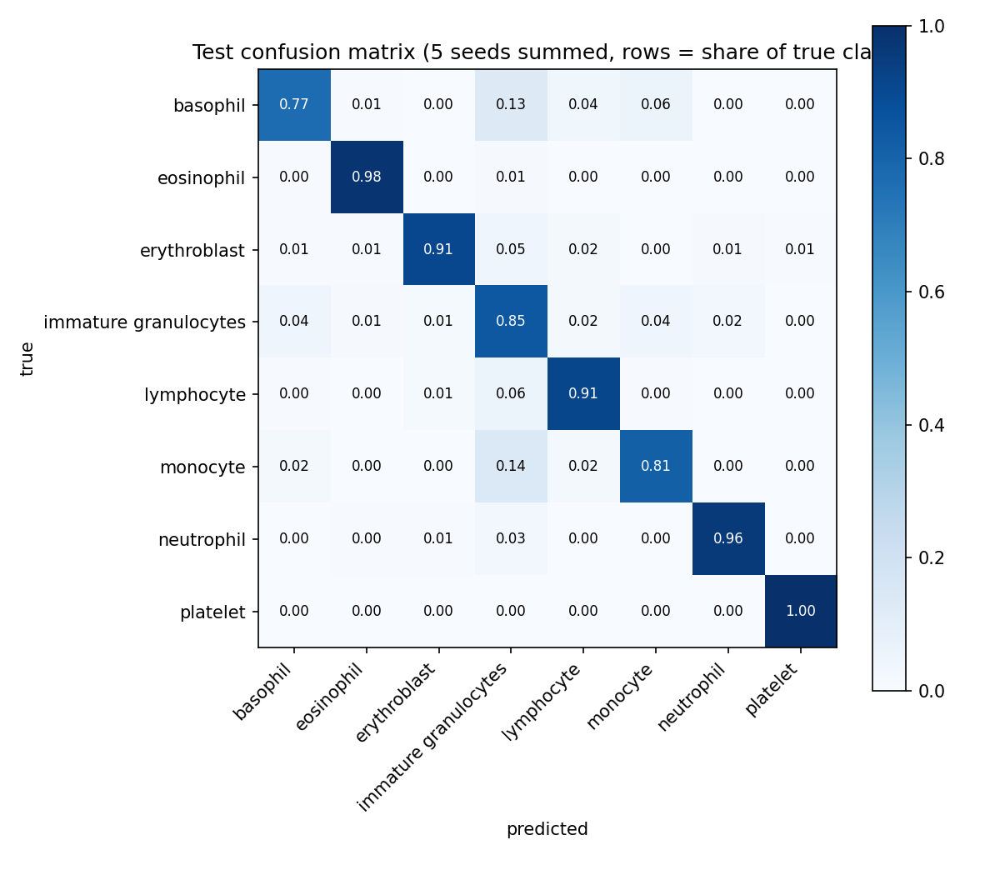

# BloodMNIST Cell Classification

Classifying blood cell images into 8 types with a small CNN, compared against simple baselines on raw pixels.

## Problem

Given a 28x28 RGB image of a single blood cell, predict its type (8 classes: basophil, eosinophil, erythroblast, immature granulocytes, lymphocyte, monocyte, neutrophil, platelet). This is a standard benchmark task, not a clinical tool.

## Objective

1. Build honest baselines (majority class, logistic regression and random forest on raw pixels).
2. Train a small convolutional neural network (CNN) and check how much it improves over the baselines.
3. Choose every setting on the validation set only, and use the test set once at the end.

## Dataset

- MedMNIST v2, BloodMNIST subset (https://medmnist.com), license CC BY 4.0.
- 17,092 images of size 28x28x3, 8 classes.
- Split: train 11,959 / validation 1,712 / test 3,421.
- Class balance: neutrophil is the largest class (19.5%); lymphocyte and basophil are the smallest (7.1% each). Proportions are the same in all three splits.
- Loaded with the `medmnist` Python package (version 3.0.2).

## Tools

Python, PyTorch, scikit-learn, NumPy, pandas, matplotlib, the `medmnist` package. Run on Kaggle notebooks with a GPU.

## Methodology

1. Baselines: majority class, logistic regression (`max_iter=100`) and random forest (200 trees, `random_state=42`), all fitted on raw pixels of the training set only.
2. CNN: three convolution layers (16, 32, 64 filters, 3x3, ReLU, max-pooling) followed by two fully connected layers (576 -> 64 -> 8), 61,032 trainable parameters. Adam optimizer, learning rate 1e-3, batch size 128, no data augmentation.
3. The CNN was trained with 5 different random seeds (0-4). For each seed, the epoch with the best validation macro-F1 was kept.
4. Number of epochs: 15 and 30 were compared on the validation set. The rule was fixed before looking at the result: count the gain only if 30 epochs is better in most seeds and the mean gain is larger than the seed standard deviation of the 15-epoch runs (0.008). Result: 30 epochs was better in 5 of 5 seeds, mean gain 0.037, so 30 epochs was used.
5. The final 5 models were retrained with 30 epochs, their best-epoch weights were saved, and these exact weights were evaluated on the test set once. No tuning was done after seeing test results.

## Preprocessing

- Baselines: each image is flattened into 2,352 values (28 x 28 x 3) and divided by 255.
- CNN: images are converted to tensors and normalised with mean 0.5 and standard deviation 0.5 per channel.
- No augmentation and no resizing.

## Evaluation

- Metrics: accuracy and macro-F1 (the average of the F1 score of each class, so small classes count as much as large ones).
- All choices (number of epochs, best epoch) were made on the validation set.
- The test set (3,421 images) was used once at the end for all final models.
- For the CNN, results are the mean and standard deviation (sample standard deviation) over the 5 seeds. The baselines were fitted once, so they have no standard deviation.
- GPU training is not perfectly repeatable: re-running the same 30-epoch code with the same seeds gave a validation macro-F1 mean of 0.908 (first run) and 0.912 (second run, whose weights were saved and used for the test set).

## Citation and acknowledgements

This project uses the MedMNIST v2 collection (BloodMNIST subset, CC BY 4.0). Following the MedMNIST authors' request, both MedMNIST papers are cited, together with the paper of the source data:

```bibtex
@article{medmnistv2,
title={MedMNIST v2-A large-scale lightweight benchmark for 2D and 3D biomedical image classification},
author={Yang, Jiancheng and Shi, Rui and Wei, Donglai and Liu, Zequan and Zhao, Lin and Ke, Bilian and Pfister, Hanspeter and Ni, Bingbing},
journal={Scientific Data},
volume={10},
number={1},
pages={41},
year={2023},
publisher={Nature Publishing Group UK London}
}

@inproceedings{medmnistv1,
title={MedMNIST Classification Decathlon: A Lightweight AutoML Benchmark for Medical Image Analysis},
author={Yang, Jiancheng and Shi, Rui and Ni, Bingbing},
booktitle={IEEE 18th International Symposium on Biomedical Imaging (ISBI)},
pages={191--195},
year={2021}
}
```

Source data of BloodMNIST: Acevedo, A., Merino, A., Alferez, S., Molina, A., Boldu, L., Rodellar, J. "A dataset of microscopic peripheral blood cell images for development of automatic recognition systems." Data in Brief, vol. 30, 105474, 2020. DOI: 10.1016/j.dib.2020.105474.

Note: the original images are 360 x 363 pixels; MedMNIST provides them downsampled to 28 x 28. MedMNIST is not intended for clinical use, and neither is this project.

## Findings

Test set (3,421 images), used once at the end. The CNN is the mean +/- standard deviation over 5 seeds (30 epochs, best epoch chosen on validation).

| Model | Test accuracy | Test macro-F1 |
|---|---|---|
| Majority class | 0.195 | 0.041 |
| Logistic regression (raw pixels) | 0.778 | 0.748 |
| Random forest (raw pixels) | 0.837 | 0.809 |
| CNN (5 seeds) | 0.916 +/- 0.006 | 0.901 +/- 0.008 |

- The CNN is clearly better than the pixel baselines on this test set. Its weakest seed (macro-F1 0.887) is still above the random forest (0.809). This holds for these specific models only; other architectures or tuned baselines were not tried.
- Validation macro-F1 of the final 5 CNNs was 0.912 +/- 0.005, and test macro-F1 was 0.901. The small drop is expected because the epoch was chosen on validation.
- Going from 15 to 30 epochs improved validation macro-F1 in 5 of 5 seeds (mean gain 0.037, larger than the seed standard deviation of 0.008), following a rule fixed before looking at the result.

Per-class test F1 of the final CNNs (mean +/- std over 5 seeds):

| Class | F1 |
|---|---|
| platelet | 0.998 +/- 0.002 |
| eosinophil | 0.981 +/- 0.003 |
| neutrophil | 0.964 +/- 0.004 |
| erythroblast | 0.927 +/- 0.008 |
| lymphocyte | 0.887 +/- 0.008 |
| monocyte | 0.824 +/- 0.024 |
| immature granulocytes | 0.823 +/- 0.011 |
| basophil | 0.801 +/- 0.028 |



The largest confusions on the test set (share of the true class, 5 seeds summed): monocyte predicted as immature granulocytes 14.0%, basophil as immature granulocytes 12.7%, lymphocyte as immature granulocytes 6.1%, basophil as monocyte 6.0%, erythroblast as immature granulocytes 4.5%, immature granulocytes as monocyte 4.5%. Four of the six largest confusions end in the immature granulocytes class. The reasons for these confusions were not investigated, so no cause is claimed here.

Earlier exploratory figures (`figures/training_curves.png`, `figures/confusion_matrix_val.png`) come from a single run (seed 42, 15 epochs) on the validation set.

## Limitations

1. **Data.** The images are only 28 x 28 pixels (downsampled from 360 x 363), so fine details are lost. It is one dataset from one hospital laboratory and one analyzer, with normal cells only (according to the source paper). Performance on other labs, devices, full-resolution images or abnormal cells is unknown.
2. **Model.** Only one small CNN without augmentation was tested. For most final seeds the best epoch was 29 or 30, so training had probably not finished improving. I did not train longer, to keep the rule of no tuning after seeing test results.
3. **Baselines.** The baselines were not tuned and were fitted once, so they have no variation estimate. Logistic regression (`max_iter=100`) did not converge, so it is probably weaker than a fully trained version.
4. **Variation and reporting.** Test macro-F1 ranged from 0.887 to 0.905 across seeds, and basophil and monocyte vary the most (std 0.028 and 0.024). GPU training is not perfectly repeatable: the same 30-epoch code gave a validation macro-F1 mean of 0.908 in one run and 0.912 in another. Validation numbers are slightly optimistic because the epoch was chosen on validation, so the test numbers are the cleaner estimate. Per-class test results were computed after the overall test result from the same saved weights; nothing was changed afterwards. The reasons for the confusions between classes were not investigated.
5. **Use.** This is a benchmark exercise on public data, not a clinical tool, and it must not be used for diagnosis.
## Future work

Not tested yet, so no result is claimed:

- Longer training or a learning-rate schedule, since the best epoch was near the last one.
- Data augmentation and other architectures (for example a deeper CNN).
- Larger image sizes: the MedMNIST package also provides larger versions of the datasets.
- Several seeds for the baselines, to get their variation.
- Looking at the images that the CNN confuses between monocyte, basophil and immature granulocytes.
- Testing on a different blood cell dataset.

## How to run

1. Open `notebooks/bloodmnist_cell_classification.ipynb` on Kaggle (Internet on, GPU on).
2. Run the cells in order from the top. The first cell installs the `medmnist` package (version 3.0.2 was used); the data is downloaded automatically.
3. The cells that save weights write to `/kaggle/working/weights`. These weight files are not in this repository.
4. The test-set cells should be run only once, at the very end, after all choices are finished.
5. Numbers can differ slightly on re-runs because GPU training is not perfectly repeatable. The numbers in this README come from the saved notebook output.
